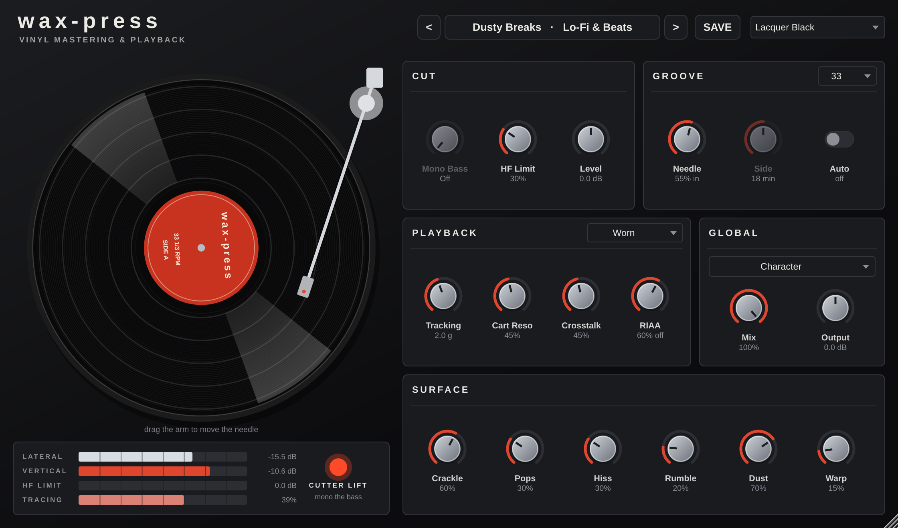

# wax-press

A vinyl mastering and playback effect (VST3 + AU + standalone). It models what happens to the
**record itself** when a mix is cut to lacquer and played back: mono bass, the cutting HF
limiter, RIAA pre-emphasis and de-emphasis (with a "cheap preamp" accuracy control),
inner-groove distortion that grows as the needle moves toward the label, stylus and cartridge,
crosstalk, and surface noise (crackle, pops, hiss, rumble, warp). It is the companion to
platterbox: platterbox is the deck, wax-press is the medium.

21 factory presets in four banks, four UI themes. See `docs/DESIGN.md` for the signal flow and DSP.



## Build

CI (`.github/workflows/build.yml`) builds universal macOS (11+) VST3 + AU + standalone and Windows x64
VST3 + standalone, runs the engine tests, makes a `.pkg` and an Inno Setup `Setup.exe`, and on a
`v*` tag publishes both to a GitHub Release.

```
cmake -B build -DCMAKE_BUILD_TYPE=Release            # fetches JUCE 8.0.4
# or: cmake -B build -DJUCE_DIR=/path/to/JUCE
cmake --build build --config Release
ctest --test-dir build                                # engine tests
```

macOS builds target macOS 11+ universal (Intel + Apple Silicon). No AVX2 or other `-march` flags
are used; the DSP is scalar C++. Windows builds use the static runtime.
`-DWAXPRESS_BUILD_TOOLS=ON` adds `WaxPressSnapshot`, which renders the theme screenshots and
smoke-tests every preset through the processor. Linux needs `libasound2-dev libx11-dev
libxrandr-dev libxinerama-dev libxcursor-dev libfreetype-dev libfontconfig1-dev libgl1-mesa-dev`.

Layout: `Source/engine` is plain C++ (parameter table, RIAA, DSP, presets) with tests in `tests/`.
`Source/plugin` is the JUCE wrapper, themes and UI. User presets are saved as `.wppreset` files in
`~/Library/Application Support/wax-press/Presets` (macOS) or `%APPDATA%\wax-press\Presets` (Windows).
