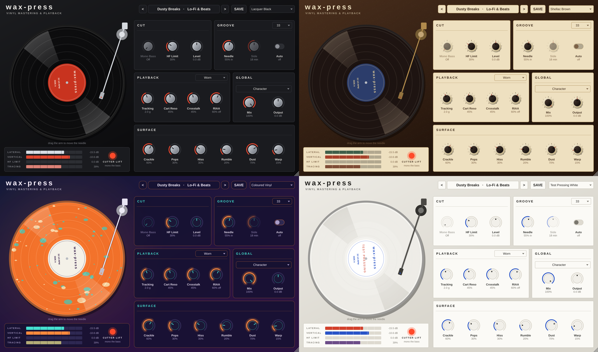

# wax-press: design

An insert effect for any track or the master that adds the **medium**: what a cut to lacquer and
playback on a turntable do to a mix. JUCE 8 + CMake, VST3 + AU + Standalone, macOS 11+ universal
(scalar C++, no `-march`) and Windows (static CRT). Effect only, no MIDI.

## Signal flow

```
in -> MONO BASS -> CUT LEVEL -> RIAA PRE-EMPHASIS -> HF LIMITER -> [lacquer sat, Character only]
      M/S + LR4    how hot      3180/318/75 us       on the boosted
                   the cut is                        top (> ~5 kHz)
   -> GROOVE TRACING ---------------------------> + SURFACE (hiss, crackle, pops: in the groove)
      odd shaper + high-passed even term + slew limit; amount from needle radius, speed, stylus, force
   -> STYLUS LP -> CARTRIDGE RESONANCE -> CROSSTALK -> RIAA DE-EMPHASIS (accuracy) -> / CUT LEVEL
   -> + RUMBLE -> WARP (wow at the rotation rate, 4 ms centre delay) -> MIX (dry phase matched) -> OUTPUT
```

Surface noise is added **before** de-emphasis, as on a real record, so hiss and clicks come out
darker, and **before** dividing by the cut level, so a hotter cut has a lower noise floor (and more
distortion), which is the real trade-off of cutting level.

## Controls

| Section | Controls |
|---|---|
| Cut | Mono Bass (Off, 50 to 300 Hz), HF Limiter, Level (-12 to +12 dB) |
| Groove | Needle position (outer to label, draggable tonearm), Auto travel + Side length (12 to 24 min), Speed 33/45/78 |
| Playback | Stylus (Conical, Elliptical, Worn), Tracking force (0.5 to 4 g), Cartridge resonance, Crosstalk, RIAA accuracy (Perfect to Cheap) |
| Surface | Crackle, Pops, Hiss, Rumble, Dust density, Warp |
| Global | Mode (Mastering Check, Character), Mix, Output |

## DSP notes

- **RIAA.** A bilinear playback filter has a zero at Nyquist, so its inverse would be unstable.
  The playback biquad instead uses matched poles and zero (z = exp(-T/t)) plus one extra real zero
  fitted at prepare time to the analog curve (minimax dB error, 20 Hz to 20 kHz). The error
  against the analog curve is 0.33 dB at 44.1 kHz, 0.22 dB at 48 kHz and 0.01 dB at 96 kHz. The
  recording filter is the exact inverse biquad, so cut then play at perfect accuracy is flat to
  rounding (tested within 0.1 dB, measured about 1e-12 dB). "Accuracy" detunes the three playback
  time constants (+16 %, -12 %, +22 % at Cheap) and moves the subsonic filter from 3 Hz up to 35 Hz.
- **Mono bass.** Mid and side go through LR4 crossovers. The side keeps only its high band; the
  mid and the dry path go through the matching 2nd-order allpass (LR4 low + high = that allpass),
  so mono material is unchanged in level and the Mix knob does not comb.
- **HF limiter.** A peak limiter on the pre-emphasised top band (x minus a 5 kHz lowpass, so the
  bands sum back exactly), as cutting engineers use to keep the cutter head safe.
- **Inner-groove distortion.** The amount k grows with (v_outer / v)^2, where v = 2 pi r rpm / 60,
  times a stylus factor (elliptical 0.45, conical 1, worn 1.8), plus mistracking below 1.6 g. The
  high band (above about 2.5 kHz) of the pre-emphasised groove goes through a tanh with groove
  headroom, a high-passed even-order term (one wall traced more than the other, without DC or
  thumps), and a slew limit. At 7 kHz, -12 dBFS, conical: about 1 % THD at the outer groove and 6 %
  at the label in Mastering Check, and about 65 % in Character, which exaggerates on purpose.
- **Surface.** This is adapted from platterbox's generator (xorshift noise, drifts). Crackle is
  Poisson impulses into six short resonant band-passes (1.5 to 9 kHz, random Q and pan), with the
  density from Dust. Pops are larger low-passed clicks. About a third of them are scratches that
  repeat at the same point of each revolution for 2 to 12 turns. Rumble is low-passed drift and
  partly vertical. Warp is wow at the platter rotation rate through a modulated delay.
- **Cutter warning.** If the side below 150 Hz, as cut, passes -20 dBFS and reaches 70 % of the mid,
  the lamp says CUTTER LIFT: out-of-phase bass would make the cutter jump. This is a real mastering
  check, and the usual fix is to raise Mono Bass.
- **Latency.** A constant 4 ms (the warp delay centre tap) is reported to the host. The dry path is
  delayed to match.

## Modes

**Mastering Check** keeps the amounts honest and is meant for checking a master before it goes to
the cutting room. **Character** exaggerates tracing distortion (drive x5, even term x5, slew limit
tighter), adds lacquer saturation, and doubles the RIAA error range.

## UI

A record seen from above (grooves, track gaps, a fixed light sheen that brightens with level, a
label that turns at the selected speed) with a tonearm that follows the needle position. Drag
anywhere on the record to place the needle. A lathe-style meter strip shows lateral and vertical
excursion, HF limiter gain reduction, tracing error and the cutter lamp. Themes: Lacquer Black,
Shellac Brown, Coloured Vinyl (translucent orange with splatter), Test Pressing White. The theme
and window size are saved with the session.



## Presets

Banks: Mastering (5), Pressings (7), Lo-Fi & Beats (5), Speeds & Oddities (4).

## Tests (`tests/EngineTests.cpp`)

The tests check the parameter table and presets, and that the RIAA round trip is flat within
0.1 dB (analytically and with sines) at 44.1 to 192 kHz. They check the playback curve against
standard values, that the cheap preamp tilts, and that transparent settings stay transparent
with latency matching the report. They also check that silence stays silent, that mono bass keeps
the mono sum and removes low side, and that inner-groove distortion orders correctly by position,
mode, stylus, speed and force. Further checks cover the HF limiter, Auto travel, the cutter
warning, every preset at three sample rates (finite, bounded, tails), and CPU.
